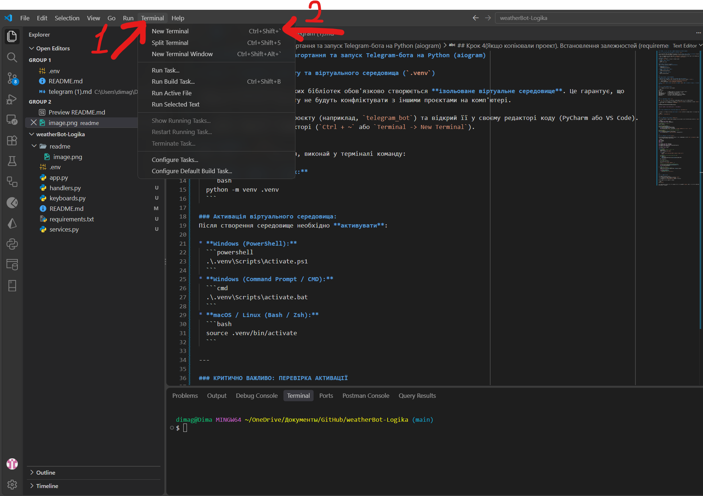
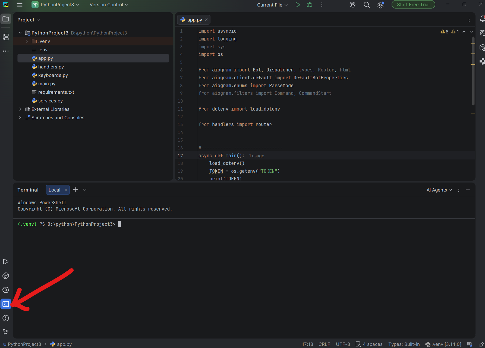

# Інструкція: Покрокове розгортання та запуск Telegram-бота на Python (aiogram)

## Крок 1. Створення проєкту та віртуального середовища (`.venv`)

Перед встановленням будь-яких бібліотек обов'язково створюється **ізольоване віртуальне середовище**. Це гарантує, що залежності поточного проєкту не будуть конфліктувати з іншими проєктами на комп'ютері.

1. Створи нову папку для проєкту (наприклад, `telegram_bot`) та відкрий її у своєму редакторі коду (PyCharm або VS Code).
2. Відкрий термінал у редакторі (`Ctrl + ~` або `Terminal -> New Terminal`).

VS Code

PyCharm



### Створення `.venv`:
Якщо папка `.venv` відсутня, виконай у терміналі команду:

* **Windows / macOS / Linux:**
  ```bash
  python -m venv .venv
  ```

### Активація віртуального середовища:
Після створення середовище необхідно **активувати**:

* **Windows (PowerShell):**
  ```powershell
  .\.venv\Scripts\Activate.ps1
  ```
* **Windows (Command Prompt / CMD):**
  ```cmd
  .\.venv\Scripts\activate.bat
  ```
* **macOS / Linux (Bash / Zsh):**
  ```bash
  source .venv/bin/activate
  ```

---

### КРИТИЧНО ВАЖЛИВО: ПЕРЕВІРКА АКТИВАЦІЇ

> **Завжди перевіряй активацію `.venv` перед виконанням будь-яких команд!**  
> У початку рядка термінала обов'язково має бути видно назву середовища в дужках: **`(.venv)`**.
> 
> * Приклад у Windows: `(.venv) PS C:\Users\User\PycharmProjects\telegram_bot>`
> * Приклад у macOS/Linux: `(.venv) user@macbook:~/telegram_bot$`
> 
> **Якщо `(.venv)` немає — команди `pip install` або запуск `python` будуть виконуватися глобально, що призведе до помилок імпорту!**

---

## Крок 2. Структура файлів проєкту

Створи у папці проєкту таку структуру файлів:

```text
telegram_bot/
│
├── .venv/               # Папка віртуального середовища (створена на Кроці 1)
├── .env                 # Конфігурація та секретні змінні оточення
├── requirements.txt     # Перелік залежностей проєкту
├── keyboards.py         # Модуль створення клавіатур (Reply / Inline)
├── handlers.py          # Обробники команд та повідомлень (маршрутизація)
└── app.py               # Головна точка входу для запуску бота
```

---

## Крок 3. Налаштування токена у `.env`

Файл `.env` використовується для збереження конфігураційних даних та ключів доступу (API keys).

1. Отримай токен бота у Telegram через офіційного бота [@BotFather](https://t.me/BotFather) (команда `/newbot`).
2. Відкрий файл `.env` і додай параметр `BOT_TOKEN`:

```env
BOT_TOKEN=1234567890:ABCdefGHIjklMNOpqrsTUVwxyZ
```

*(Значення вказується без пробілів навколо `=` і без лапок).*

---

## Крок 4.1(Якщо копіювали проект). Встановлення залежностей (`requirements.txt`)


Переконайся, що віртуальне середовище **активоване** (`(.venv)` присутнє у терміналі), після чого виконай встановлення:

```bash
pip install -r requirements.txt
```

## Крок 4.2(Якщо з нуля). Встановлення залежностей (`requirements.txt`)


Переконайся, що віртуальне середовище **активоване** (`(.venv)` присутнє у терміналі), після чого виконай встановлення:

### Скачування бібліотек
```bash
pip install назва бібліотеки
```

### Створення `requirements.txt`
```bash
pip freeze > requirements.txt
```

---

## Крок 5. Написання коду обробників (`handlers.py`)

У цьому файлі описується бізнес-логіка реагування бота на команди та текстові повідомлення за допомогою `Router`.

```python
from aiogram import Router, types
from aiogram.filters import CommandStart

# Ініціалізація маршрутизатора
router = Router()

# Обробник команди /start
@router.message(CommandStart())
async def cmd_start(message: types.Message):
    user_name = message.from_user.first_name
    await message.answer(f"Вітаю, {user_name}! Бот успішно запущений і готовий до роботи.")

# Обробник усіх інших текстових повідомлень (Ехо-функція)
@router.message()
async def echo_handler(message: types.Message):
    await message.answer(f"Отримано повідомлення: {message.text}")
```

---

## Крок 6. Написання точки входу (`app.py`)

Головний файл відповідає за завантаження змінних оточення, ініціалізацію об'єктів `Bot` та `Dispatcher`, підключення роутерів і запуск поллінгу (Long Polling).

```python
import asyncio
import logging
import os

from aiogram import Bot, Dispatcher
from aiogram.client.default import DefaultBotProperties
from aiogram.enums import ParseMode

from dotenv import load_dotenv

from handlers import router


#----------- ------------------
async def main():
    load_dotenv()
    TOKEN = os.getenv("TOKEN")
    print(TOKEN)

    bot = Bot(
        token=TOKEN,
        default=DefaultBotProperties(parse_mode=ParseMode.HTML),
    )
    dp = Dispatcher()
    dp.include_router(router)
    print('Бот успішно запущений')
    await dp.start_polling(bot)

if __name__ == '__main__':
    logging.basicConfig(level=logging.INFO)
    try:
        asyncio.run(main())
    except KeyboardInterrupt:
        print('Бот зупинено')
```

---

## Крок 7. Запуск проєкту

Перед запуском виконай чек-лист:
- [ ] У терміналі активне віртуальне середовище `(.venv)`.
- [ ] У файлі `.env` вказано дійсний `BOT_TOKEN`.
- [ ] Всі залежності з `requirements.txt` успішно встановлено.

Виконай запуск головного файлу у терміналі:

```bash
python app.py
```

Якщо налаштування виконано вірно, у терміналі з'являться логи запуску `aiogram`, після чого бот почне відповідати на повідомлення в Telegram.